# Photos

Back to the [README](README.md).

## The printed parts

Two printed 5.25" blanks installed in my XPS 410.

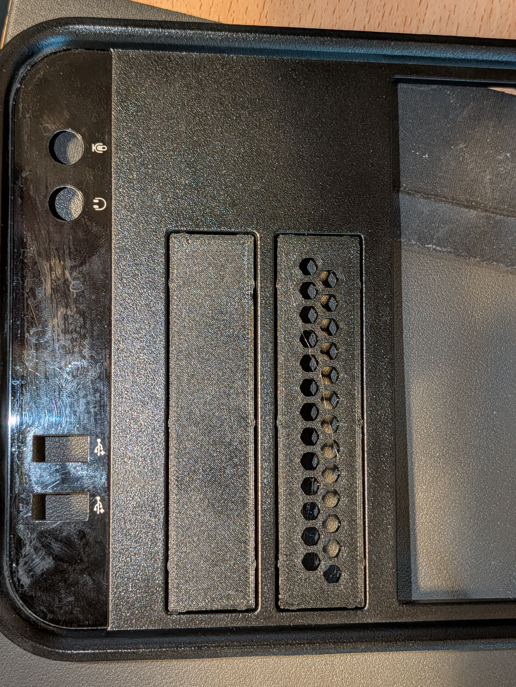

Two printed 3.5" blanks installed: stock on the left, Let it breathe honeycomb (with the more flush face) on the right.

Back view: my print next to the original Dell blank (the one with the sticker), both holding the spare screws.

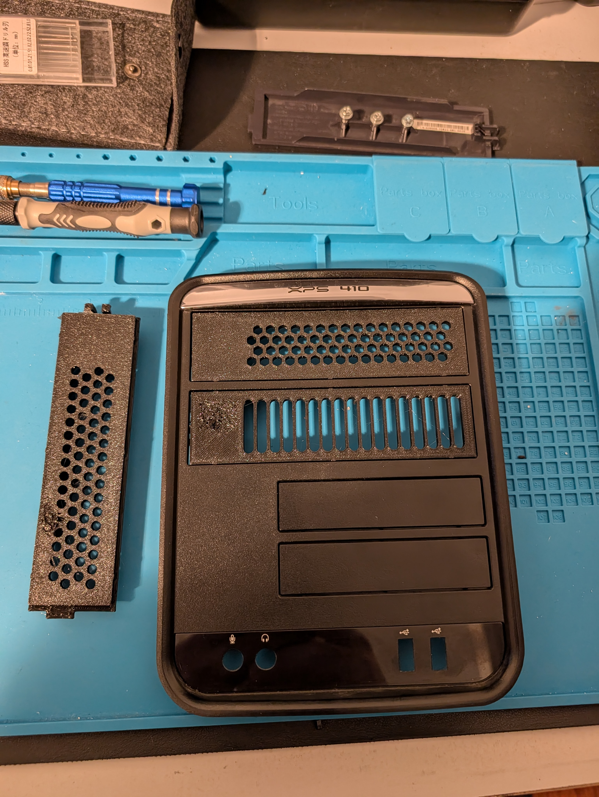

Let it breathe: the honeycomb (top) and slots versions installed in the front panel, the round-hole version on the bench.

## Removing the supports

Slicer preview of the latch end: keep the latch arms (green), break off the nub under each arm (red).

One pair of needle nose pliers holding the latch arm, the second pair on the nub.

One nub removed.

Both nubs removed.

## The original Dell 5.25" blank (J8997)

These are for shape only; the camera angles make their scale unreliable, so the dimensions in [MEASUREMENTS.md](MEASUREMENTS.md) came from calipers.

Front face.

Back, with a ruler (best overall view).

Back, with the spare screws in the bosses.

Side profile: rails, ramps and latch.

End view.

Edge view, showing the crush nubs.

Latch end from the back, with a ruler.

Latch side profile with a ruler (the bend at the end of the arm).

Tab close-up with a ruler.

## The original Dell 3.5" blank (HJ485)

As above, for shape only; the dimensions in [MEASUREMENTS-3.5in.md](MEASUREMENTS-3.5in.md) came from calipers.

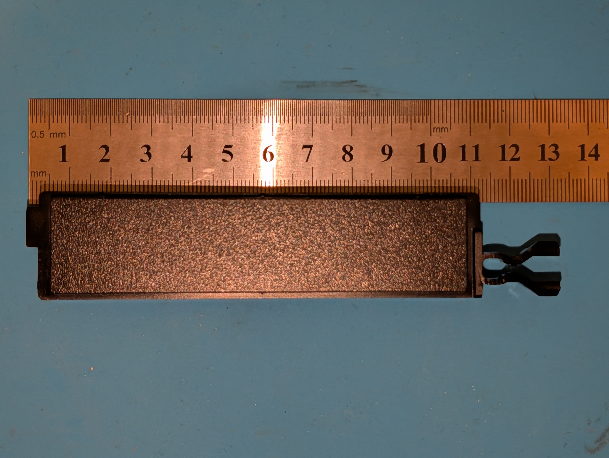

Front face with a ruler: tab on the left, latch on the right, as installed.

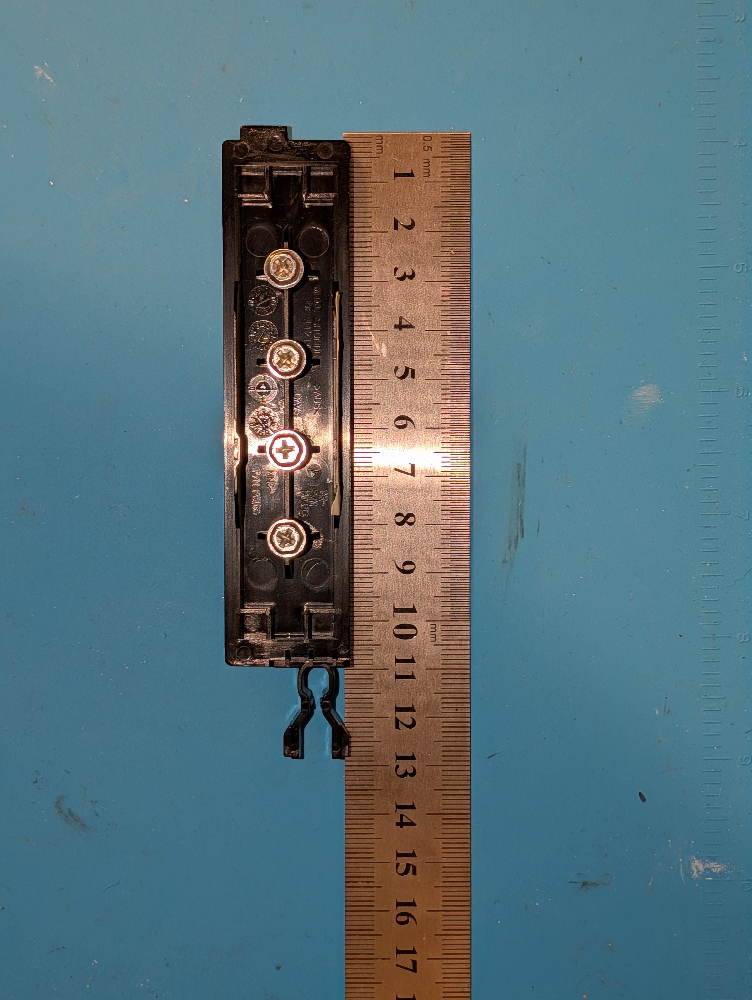

Back, with a ruler (best overall view): pocket, fins, the four screw bosses and the corner boxes.

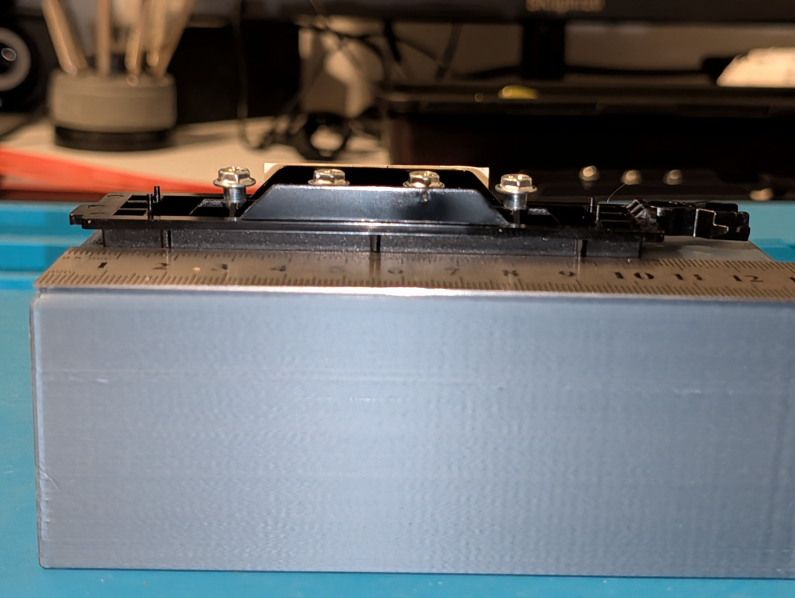

Side profile: the fins and the latch.

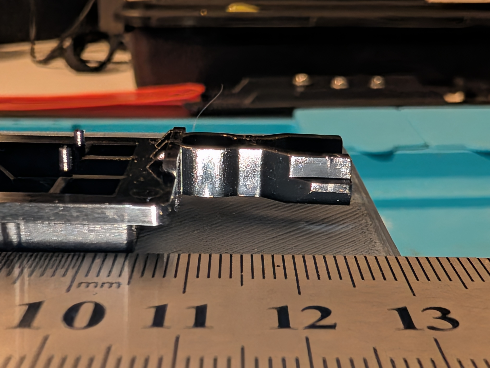

Latch close-up from the side: the end wall and its braces.

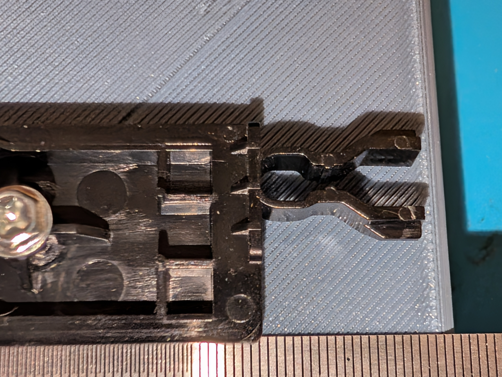

Latch from the back: the U, the waist, the S-bend and the hooks.

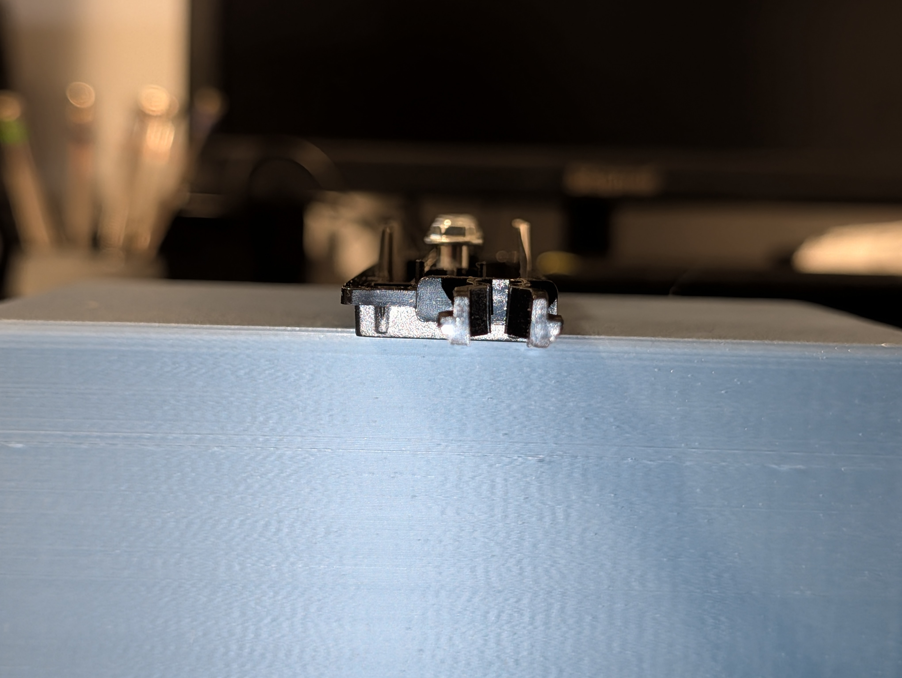

Latch end view, part face down: the hooks' ramps are on the face side.

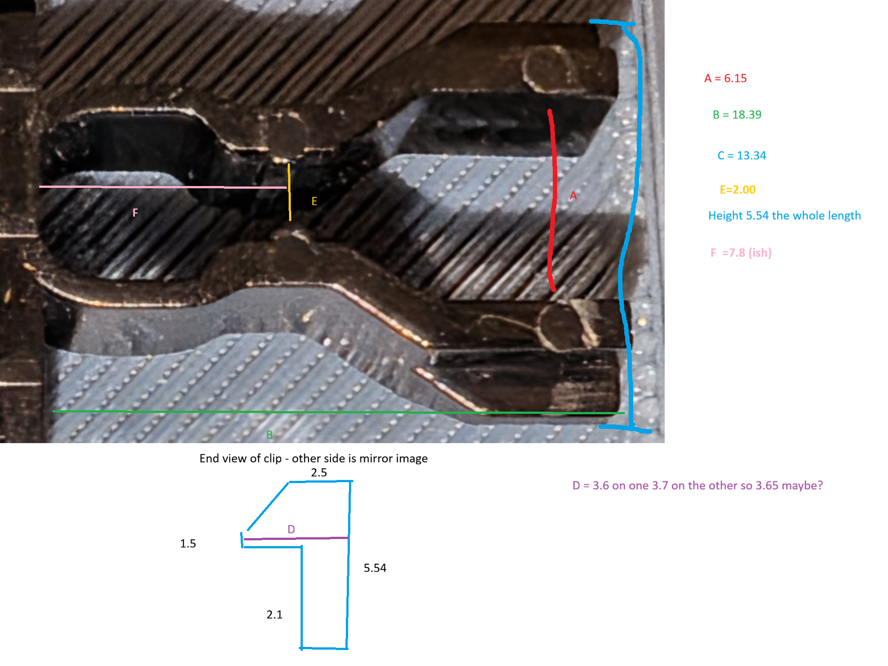

My sketch of the latch with the caliper readings (A to F). The end view sketch is drawn face up, so it's upside down compared with the photo above.

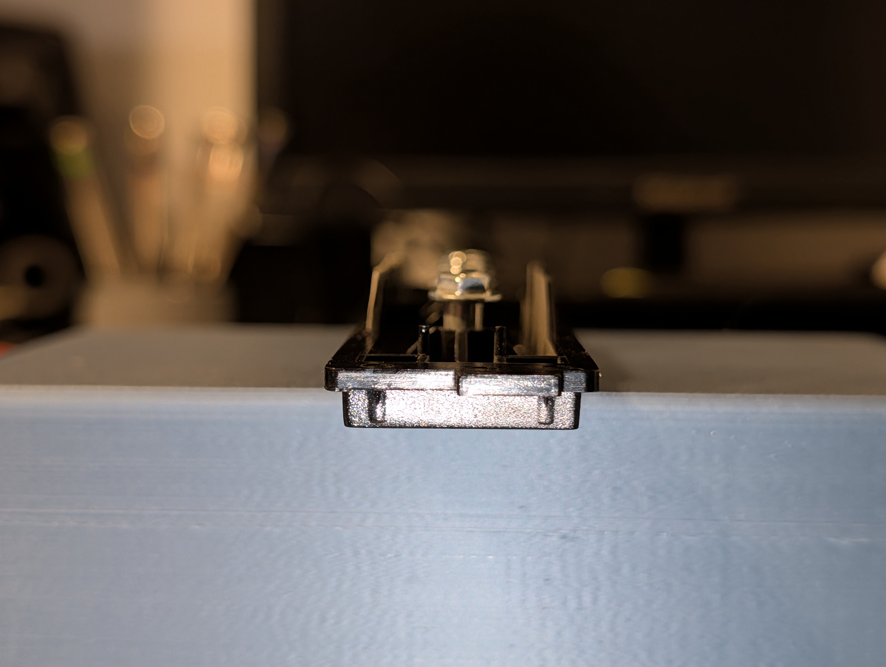

Tab end view.

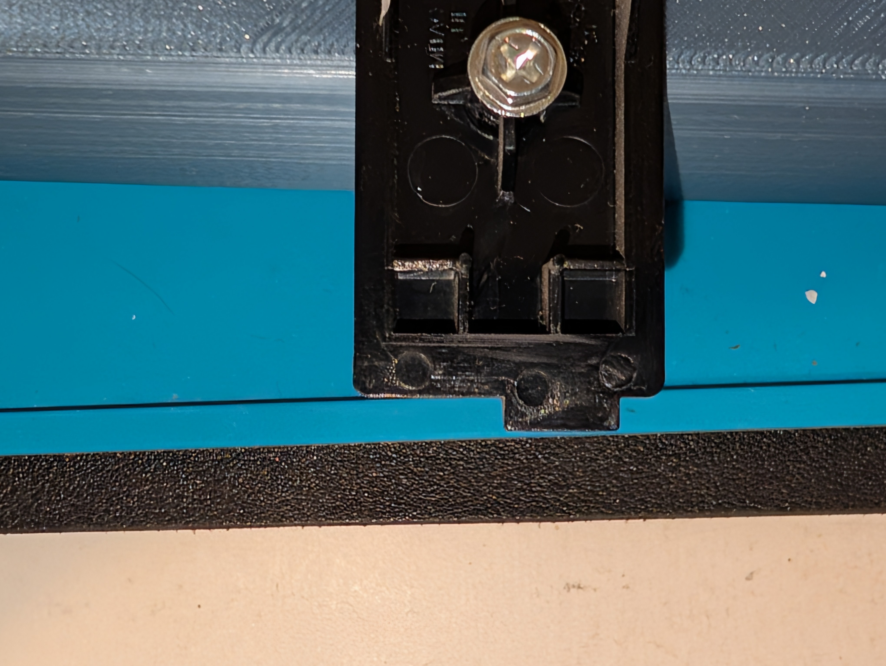

Tab close-up.
