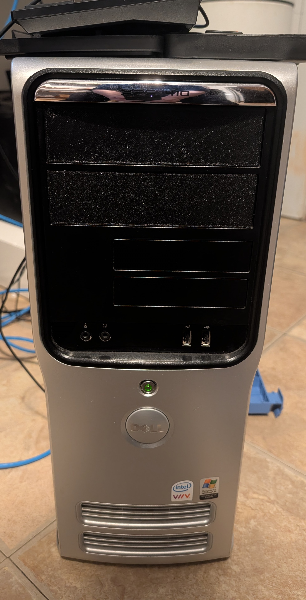
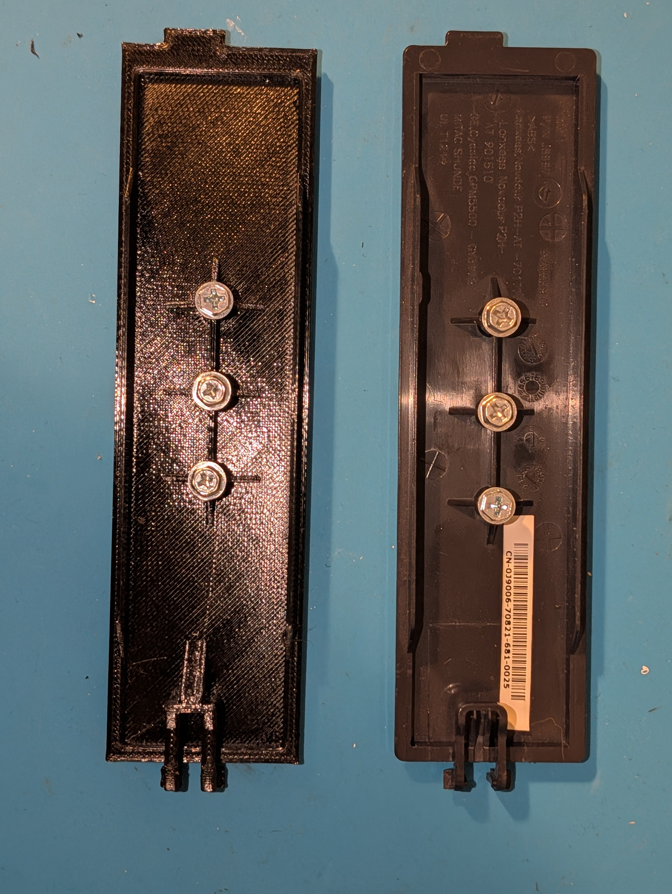
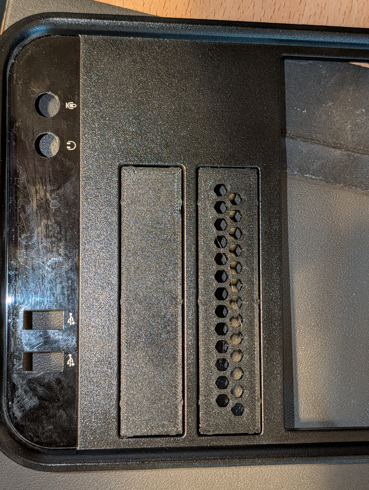
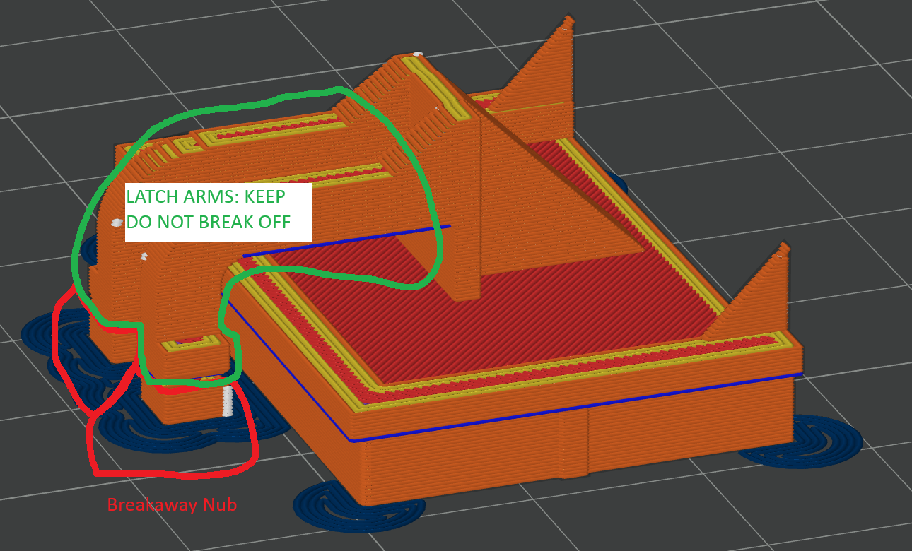
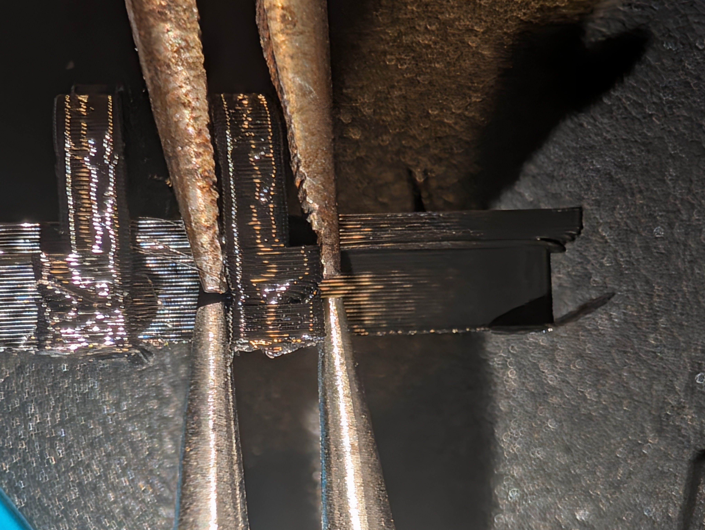
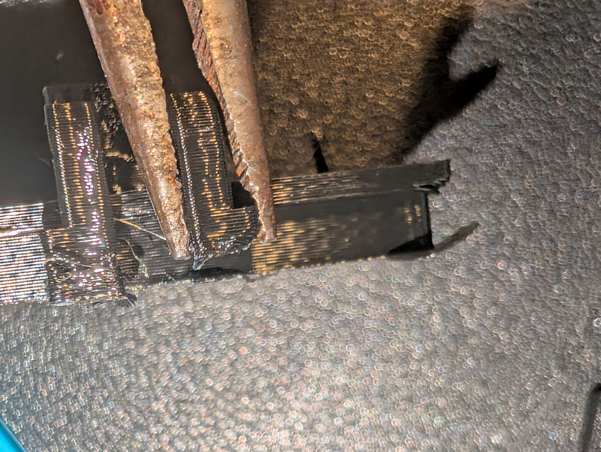
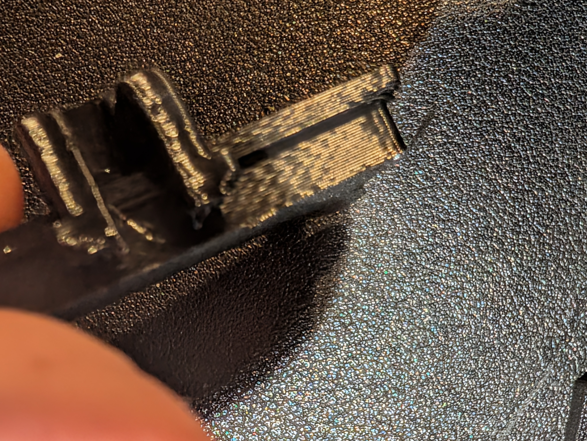
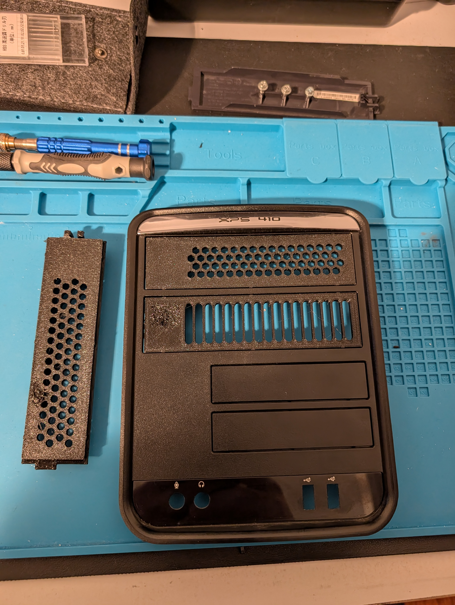

# Dell XPS 410 drive bay blanks: 5.25" (J8997) and 3.5" (HJ485)

I'm turning my old Dell XPS 410 into a NAS, and pulling the drives left empty 5.25" and 3.5" bays. I only had one genuine Dell blank of each size, so I measured them with calipers and modeled printable replacements.
This repo has the parametric OpenSCAD source for both, ready-to-print STLs, and my full measurement record of each original part.

Back view: my 5.25" print next to the original Dell blank (the one with the sticker), both holding the spare screws.

Two 3.5" blanks installed: stock on the left, Let it breathe honeycomb on the right.

> **AI-assisted.** I made this with the help of Claude (Anthropic) in Claude Code: the OpenSCAD code, documentation and research were written with AI assistance.
> I did the measuring, every test print, and made the design decisions.

**Part numbers and search terms**

- **5.25" blank:** Dell J8997 / 0J8997 (molded inside), HH978 (molded inside), DP/N 0J9006 (sticker), possibly FH991 (see Compatibility).
  5.25 inch bay blank, drive bay cover, optical drive bay filler, ODD filler, drive panel insert, CD/DVD bay cover.
- **3.5" blank:** Dell HJ485 (BK-P/N, molded inside), P8106 (MNG-P/N, molded inside), DP/N 0KJ293 / KJ293 (sticker).
  3.5 inch bay blank, 3.5 inch bay cover, floppy bay blank, card reader bay filler, FDD filler, drive slot cover.

## Compatibility

**5.25" blank (J8997)**

| Model | Status |
|---|---|
| Dell XPS 410 | **Tested**: fits and latches like the original |
| Dell Dimension 9200 | Same machine as the XPS 410 under another name, same part (J8997); should fit |
| Dell XPS 400, Dimension 9150, Dimension 9100 | Appears to be the same part (same drive panel and latch), but I couldn't find a source naming the part number; untested |
| Dell Precision 390, 490, T3400, T3500 | **May fit**: their filler, FH991, looks identical and is listed by a seller as compatible with J8997; untested |

**3.5" blank (HJ485)**

| Model | Status |
|---|---|
| Dell XPS 410 | **Tested**: fits and latches like the original |
| Dell Dimension 9200 | Same machine as the XPS 410 under another name; should fit, untested |
| Dell PowerEdge SC440 | **May fit**: a seller lists this blank (HJ485, P8106, KJ293) as an SC440 part; untested |

**To check your own machine:** look inside your existing blank for **J8997** (5.25") or **HJ485** / **P8106** (3.5") molded into the plastic.
Measurements: the 5.25" original's outer lip is ~146.66 x ~39.62 mm; the 3.5" original's flange is ~106.18 x ~25.8 mm. Both have a tab at one end and a two-arm squeeze latch at the other.
If you try either one on another model, please open an issue and let me know how it went.

## Files

| File | What |
|---|---|
| **5.25" blank** | |
| `stl/xps410_bay_blank.stl` | The part, with breakaway supports built in. Print this. |
| `stl/xps410_bay_blank_breathe_honeycomb.stl` | Let it breathe: honeycomb vents, no screw bosses (my favorite) |
| `stl/xps410_bay_blank_breathe_round.stl` | Let it breathe: round vent holes, no screw bosses |
| `stl/xps410_bay_blank_breathe_slots.stl` | Let it breathe: slot vents, no screw bosses |
| `stl/test/latch_test.stl` | Just the latch end, to check that the latch fits and clicks into your computer before printing the whole part |
| `stl/test/boss_test.stl` | Five screw bosses with hole sizes 2.6 to 3.0 mm, to tune the spare-screw holes if desired |
| `xps410_bay_blank.scad` | Parametric OpenSCAD source (OpenSCAD 2021.01 or later) |
| `MEASUREMENTS.md` | Every dimension of the original part and where it came from |
| **3.5" blank** | |
| `stl/xps410_3.5_bay_blank.stl` | The part, with breakaway supports built in. Print this. |
| `stl/xps410_3.5_bay_blank_breathe_honeycomb.stl` | Let it breathe: honeycomb vents, more flush face, no screw bosses |
| `stl/xps410_3.5_bay_blank_breathe_round.stl` | Let it breathe: round vent holes (not test printed yet; same part as the honeycomb except the holes) |
| `stl/xps410_3.5_bay_blank_breathe_slots.stl` | Let it breathe: slot vents (not test printed yet; same part as the honeycomb except the holes) |
| `stl/test/xps410_3.5_latch_test.stl` | Just the latch end, to check the latch before printing the whole part |
| `stl/test/xps410_3.5_coupon.stl` | Just the front plate (face, crush nubs, flange, tab), to check the fit in the opening |
| `xps410_3.5_bay_blank.scad` | Parametric OpenSCAD source (OpenSCAD 2021.01 or later) |
| `MEASUREMENTS-3.5in.md` | Every dimension of the original part and where it came from |
| **Both** | |
| `photos/` | Photos of the original Dell parts and the printed ones; see [PHOTOS.md](PHOTOS.md) to view them all |

## Printing

I printed mine on a Creality Ender-3 V3 SE (stock 0.4 mm nozzle, textured PEI plate) with OrcaSlicer 2.5, the 5.25" in PLA and PETG, the 3.5" in PETG.

- **Orientation:** face down, exactly as the STL loads. The plate's texture becomes the matte front face, matching the original.
- **Plate:** textured PEI.
- **Supports: OFF in the slicer.** The breakaway supports are part of the model, with a deliberate small air gap so they snap off easily: on the 5.25", pillars under the latch arms and a shelf under the tab and the lip on the tab side; on the 3.5", a fence under each latch arm and shelves under the flange at both ends.
- **The slicer warning is expected.** OrcaSlicer says `It seems object <name>.stl has floating regions. Please re-orient the object or enable support generation.` That is the built-in air gap. Click OK and print; do not enable supports.
- **Layer height:** 0.2 mm.
- **Brim:** a mouse-ear brim stops the corners of the blank lifting in PETG for me.

### PETG settings that worked for me

| Setting | Value |
|---|---|
| Nozzle | 230 °C |
| Bed | 80 °C |
| Flow ratio | 0.95 |
| Cooling | none for the first 3 layers, full speed at layer 5; fan 30 % to 90 % by layer time; keep fan always on: off |
| Overhangs and bridges fan | 90 %, forced |
| First layer infill speed | 40 mm/s (the Creality profile's 80 left a glossy, badly stuck patch where the face's first layer fill starts, on the 3.5" blank) |

### Removing the supports

1. **Let it cool fully** before touching the supports: about 15 to 20 minutes, until the bed is under 30 °C and the part feels room temperature.
2. **Use needle nose pliers to support the latch arm** and use a second set of pliers to break off the nub. (The small support pillar under the end of each latch arm). Do not break them off by hand, you'll probably snap an arm. Ask me how I know.

   

     

   In order: one pair of pliers holding the arm and one on the nub; one nub off; both nubs off.

   On the 3.5" blank the support under each arm is a thin fence along the whole arm instead of a nub. Same method: hold the arm with one pair of pliers and peel the fence off with the other.
   **Do the arms first:** loosen the fences under both arms this way before you try to remove the shelf under the flange at the latch end.
3. There is also a breakaway support under the tab; there is a small extension you can grab with pliers and it should come off quite easily. The 3.5" blank has a second shelf under the flange at the latch end; it comes off the same way, once the arm fences are loose (step 2).

## Fit and use

- The bosses on the back store spare drive screws, as on the originals: three on the 5.25", four on the 3.5". The screws thread straight into the 3.0 mm holes for me. You can also turn them off in the options.
- **The 3.5" blank's face is about 1 mm inset in the front panel.** So is Dell's original (the 5.25" sits flush), so the stock blank copies it. I didn't like it, so the 3.5" model has a `more_flush` option that makes the face 1 mm deeper; everything behind the face stays the same, so the fit and the latch don't change. It is off for the stock blank and on by default for the Let it breathe versions.

## Let it breathe (NAS mode)

The real reason I made these: my XPS 410 is becoming a NAS, and I'm mounting a fan behind the drive stack to pull air through the chassis. A solid blank blocks that, so both models have a vented option.
Pick it with `let_it_breathe` in the Customizer: **Stock (no air)**, **Round holes**, **Honeycomb** or **Slots**. Any vented choice drops the screw bosses, since they would sit in the airflow; on the 3.5" it also drops the four small boxes in the pocket corners, so the vents can use the whole pocket.
The vents stop short of the edges and the latch, so the fit and the latch are exactly the same as the stock part. Ready-made STLs for all three are in `stl/`.

All three 5.25" versions printed in PETG and all three fit: honeycomb (top) and slots installed, round holes on the bench. Honeycomb is my favorite, and it's the one I printed for the 3.5" bays too (see the photo at the top).

## Customizing

Open the `.scad` file in OpenSCAD and use the Customizer (Window > Customizer). Every dimension is a named variable. These are the ones worth adjusting.

### 5.25" blank (`xps410_bay_blank.scad`)

| Variable | Default | What it is, and when to change it |
|---|---|---|
| `part` | `full` | What to build. `full` is the whole blank; the others are small test pieces: `latch_test` (just the latch end), `boss_test` (screw holes in five sizes), `coupon` (just the front plate, to check the fit in the opening). |
| `nub_h` | 0.3 | Height of the **crush nubs**: the six small bumps (three on top, three on the bottom) along the edges of the raised front face. They press against the opening so the blank doesn't rattle. Raise it if the blank is loose in the opening, lower it if it's too tight. |
| `leg_bottom_z` | 1.95 | Position of the **latch hooks**: the catches on the ends of the two latch arms (latch side) that click behind the bezel. Measured from the front face. Lower it if the hooks don't reach far enough to catch, raise it if they catch too early; about 0.2 per layer line. |
| `boss_hole_d` | 3.0 | Hole size in the **screw bosses**: the three round posts on the back that hold spare drive screws. Raise it if the screws won't go in, lower it if they fall out. The posts get wider with the hole. |
| `brace` | `pocket` | Shape of the **latch brace**: the support behind the U where the two latch arms join. `pocket` (a solid wedge) is strongest. `original` roughly copies the original Dell brace but was too weak in my testing; `hybrid` is in between. |
| `support_gap` | 0.3 | Air gap between the part and the **built-in support under the tab** (tab side). Raise it if that support fuses to the part, lower it if the tab sags onto it. |
| `leg_support_gap` | 0.25 | Same, for the **support pillars under the latch arms** (latch side). |
| `print_supports` | true | Set to false to leave out the built-in supports, if you would rather use your slicer's. |
| `include_screw_bosses` | true | Set to false to leave out the screw bosses. |
| `let_it_breathe` | `stock` | Vent holes for airflow (see Let it breathe): `stock` (no air), `round`, `honeycomb` or `slots`. Any vented choice also leaves out the screw bosses. |
| `vent_hole` | 5.0 | Size of each vent: the diameter for round holes, across the flats for honeycomb, the width for slots. Bigger lets more air through. |
| `vent_web` | 1.6 | Plastic left between neighbouring vents. Raise it for a stiffer plate, lower it for more open area (keep it at least 3 or 4 nozzle widths). |
| `vent_margin` | 2.5 | Solid strip kept between the vents and the pocket edges and latch brace. |

### 3.5" blank (`xps410_3.5_bay_blank.scad`)

| Variable | Default | What it is, and when to change it |
|---|---|---|
| `part` | `full` | What to build: `full` is the whole blank, `latch_test` just the latch end, `coupon` just the front plate to check the fit in the opening. |
| `let_it_breathe` | `stock` | Vent holes for airflow, as on the 5.25": `stock`, `round`, `honeycomb` or `slots`. Any vented choice also leaves out the screw bosses and the corner boxes. `vent_hole`, `vent_web` and `vent_margin` work the same as on the 5.25". |
| `more_flush` | `auto` | Makes the face 1 mm deeper so it sits nearly flush in the front panel instead of 1 mm inset like the original (see Fit and use). `auto` turns it on only for the vented versions; `on` and `off` force it. `flush_extra` (1.0) sets how much. |
| `nub_h` | 0.3 | Height of the **crush nubs**: three on each long edge of the face and two on each short end. Raise it if the blank is loose in the opening, lower it if it's too tight. `end_nubs` turns the ones on the short ends off. |
| `hook_stem_h` | 3.3 | Position of the **latch hooks**: the plain part of each arm behind the hook's catch. Raise it to move the catch toward the face, lower it to move it back; about 0.2 per layer line. (The original measured 2.1; 3.3 is what latched in my tests.) |
| `boss_hole_d` | 3.0 | Hole size in the four **screw bosses**, as on the 5.25". |
| `include_screw_bosses` | true | Set to false to leave out the screw bosses. |
| `include_corner_boxes` | true | The four small hollow boxes in the pocket corners. They're on the original but I found no purpose for them; set to false to leave them out. |
| `support_gap` | 0.3 | Air gap above the **shelves under the flange** at both ends. |
| `arm_support_gap` | 0.25 | Same, for the **fences under the latch arms**. |
| `face_support_xy` | 0.6 | Side gap between the latch-end shelf and the face. 0.4 fused to the face in PETG for me; raise it if yours does too. |
| `print_supports` | true | Set to false to leave out the built-in supports, if you would rather use your slicer's. |

## Photos

See **[PHOTOS.md](PHOTOS.md)** for all the photos: the printed parts, support removal, and both original Dell parts from every side. The photos of the originals are in `photos/`. They're for shape only; the camera angles make their scale unreliable, so every dimension came from calipers wherever possible (see `MEASUREMENTS.md` and `MEASUREMENTS-3.5in.md`).

## Not affiliated with Dell

This is an independent design made by measuring original parts. It contains no Dell logo or artwork.
Dell, XPS, Dimension, Precision and PowerEdge are trademarks of Dell Inc.; they are used here only to say which computers the parts fit.

## License

[Creative Commons Attribution-ShareAlike 4.0 International (CC BY-SA 4.0)](https://creativecommons.org/licenses/by-sa/4.0/). See [LICENSE](LICENSE).
You may use, change, share and sell it, as long as you credit this project and share changed versions under the same license.
